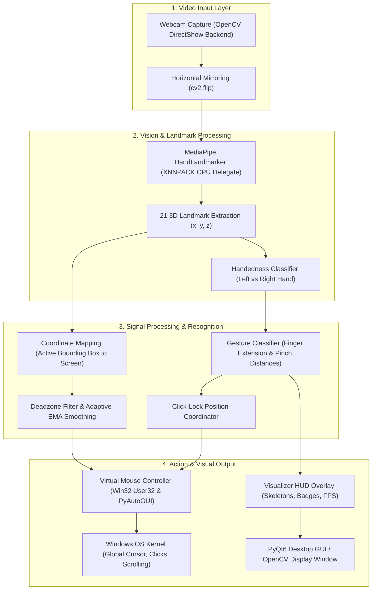

# Virtual Hand Cursor Using Hand Gesture Recognition

[](https://www.python.org/)
[](https://developers.google.com/mediapipe)
[](https://opencv.org/)
[](https://riverbankcomputing.com/software/pyqt/)
[](https://microsoft.com)
[](LICENSE)

An advanced, touch-free Human-Computer Interaction (HCI) system that transforms live webcam hand gestures into operating system mouse navigation, left-clicks, right-clicks, and bidirectional scrolling across all desktop applications, web browsers, and document viewers.

---

## 🎓 Academic Project Information

- **Project Type**: Bachelor of Computer Applications (BCA) Mini Project
- **Institution**: Vidyavahini First Grade & P.G. College, Tumakuru
- **Affiliation**: Affiliated to Tumkur University
- **Department**: Department of Computer Applications
- **Project Guide**: **Navyashree S**, Department of Computer Science
- **Team Members**:
  1. **Ananya M P** (Reg. No: `U11VU24S0036`)
  2. **Bhoomika** (Reg. No: `U11VU24S0349`)
  3. **Manasa K S** (Reg. No: `U11VU24S0070`)
  4. **Shubha C S** (Reg. No: `U11VU24S0304`)

---

## 📌 Table of Contents
1. [Overview & Problem Statement](#-overview--problem-statement)
2. [Key Innovations & Technical Features](#-key-innovations--technical-features)
3. [System Architecture](#-system-architecture)
4. [The 7 Core Modules](#-the-7-core-modules)
5. [Mathematical Models & Algorithms](#-mathematical-models--algorithms)
6. [Gesture Mapping & Control Schema](#-gesture-mapping--control-schema)
7. [Directory Structure](#-directory-structure)
8. [Installation & Execution](#-installation--execution)
9. [Configuration & Tuning](#-configuration--tuning)
10. [Automated Testing & Verification](#-automated-testing--verification)

---

## 📖 Overview & Problem Statement

### The Problem
Traditional computer interaction relies fundamentally on physical hardware mice and trackpads. While effective, this creates multiple challenges:
- **Repetitive Strain & Physical Contact**: Continuous physical gripping can lead to strain, fatigue, or carpal tunnel issues.
- **Hardware Failure & Maintenance**: Physical switches degrade, cables fray, and sensor trackballs/optics require flat surfaces.
- **Sterile & Touch-Free Environments**: In clinical settings, industrial workshops, kitchen counters, or presentation auditoriums, touching physical peripherals is either unhygienic or impractical.

### The Proposed Solution
The **Virtual Hand Cursor** utilizes computer vision and hand landmark estimation to establish a touch-free virtual mouse. Using an off-the-shelf built-in or USB webcam, the system:
1. Detects and tracks 21 three-dimensional hand landmarks at 30+ FPS.
2. Isolates cursor guidance and mouse actions across dual hands or a single hand.
3. Applies mathematical smoothing, deadzone filtering, and click-lock position freezing to eliminate hand tremors.
4. Directly interfaces with the Windows OS kernel to move the cursor, click buttons, and scroll windows across any software.

---

## ⚡ Key Innovations & Technical Features

- **Dual-Hand Isolation Architecture (Zero Click-Jitter)**:
  - **Right Hand**: Directs pointer trajectory with the index fingertip.
  - **Left Hand**: Triggers discrete actions (Left Click, Right Click, Scroll Up/Down).
  - *Advantage*: Eliminates the involuntary mouse pointer jerk that occurs when pinching fingers on the same hand!
- **Click-Lock Position Freezing**:
  - The moment a pinch gesture is detected, cursor coordinates are locked at the target position for $0.35\text{s}$, preventing button target drift.
- **Adaptive Deadzone Tremor Filter**:
  - Distinguishes between intentional slow hovering and involuntary human hand tremor ($< 8\text{px}$ deadzone).
- **Native Windows Kernel Integration**:
  - Built with native Windows `User32` APIs (`SetCursorPos`, `mouse_event`) with Per-Monitor High-DPI awareness for zero-latency, full-desktop response.
- **Privacy-First Camera Management**:
  - Camera is **OFF** by default. Only activates upon explicit user action and releases hardware instantly when stopped.
- **Standalone Distribution**:
  - Packaged into a self-contained executable ([`HandCursor_Standalone.exe`](HandCursor_Standalone.exe)) requiring no Python installation.

---

## 🏗️ System Architecture



---

## 🧩 The 7 Core Modules

Following the specifications in Section 5 of the project synopsis:

### Module 1: Video Capture (`cv2.VideoCapture`)
Captures real-time frames from the camera. Uses the Windows DirectShow backend (`cv2.CAP_DSHOW`) to avoid Media Foundation (MSMF) deadlocks and ensure consistent frame acquisition at 640×480 resolution at 30 FPS.

### Module 2: Hand Detection (`mediapipe.tasks.vision.HandLandmarker`)
Detects single or dual hands simultaneously using deep convolutional networks optimized with TensorFlow Lite XNNPACK delegates for low CPU overhead.

### Module 3: Hand Landmark Tracking
Extracts 21 spatial landmarks per hand, capturing precise fingertip points (Thumb: 4, Index: 8, Middle: 12, Ring: 16, Pinky: 20) and interphalangeal joints.

### Module 4: Gesture Recognition (`src/gesture_classifier.py`)
A finite-state gesture engine determining:
- Finger extension status: $y_{tip} < y_{pip}$
- Relative pinch distance between thumb and finger tips.
- Discrete gesture outputs: `MOVE`, `LEFT_CLICK`, `RIGHT_CLICK`, `SCROLL_UP`, `SCROLL_DOWN`, and `IDLE`.

### Module 5: Cursor Control (`src/mouse_controller.py`)
Projects coordinates from the calibrated camera active bounding box ($100\text{px}$ margin) to the full screen resolution ($1920 \times 1080$), applying mathematical smoothing to eliminate jitter.

### Module 6: Mouse Action Control
Dispatches hardware mouse events into the operating system:
- **Left Click**: Dispatches `MOUSEEVENTF_LEFTDOWN` followed by `MOUSEEVENTF_LEFTUP`.
- **Right Click**: Dispatches `MOUSEEVENTF_RIGHTDOWN` followed by `MOUSEEVENTF_RIGHTUP`.
- **Scroll**: Dispatches `MOUSEEVENTF_WHEEL` with direction and step magnitude.
- Cooldown timers prevent unintended double-click spam.

### Module 7: Visual Feedback (`src/visualizer.py` & `app_desktop.py`)
Draws visual feedback directly onto the video feed:
- 21-node bone skeleton and joint nodes.
- Golden-ratio active tracking bounding box.
- Dynamic color-coded action banners with real-time FPS counter.
- Independent status badges for Right Hand and Left Hand tracking.

---

## 📐 Mathematical Models & Algorithms

### 1. Pinch Distance Calculation (Euclidean Metric)
Pinch detection calculates the Euclidean distance between fingertip $A(x_1, y_1)$ and fingertip $B(x_2, y_2)$ in pixel space:
$$d(A, B) = \sqrt{(x_2 - x_1)^2 + (y_2 - y_1)^2}$$
- **Left Click Trigger**: $d(\text{Thumb Tip}_4, \text{Index Tip}_8) < 38\text{px}$
- **Right Click Trigger**: $d(\text{Thumb Tip}_4, \text{Pinky Tip}_{20}) < 42\text{px}$ (uses small finger to completely eliminate index/middle finger confusion)

### 2. Coordinate Linear Interpolation
Maps camera coordinates $(C_x, C_y)$ within active margins $[M_x, W - M_x]$ to monitor resolution $[0, S_w]$:
$$S_x = \frac{C_x - M_x}{(W - 2M_x)} \times S_{\text{width}}$$
$$S_y = \frac{C_y - M_y}{(H - 2M_y)} \times S_{\text{height}}$$

### 3. Speed-Adaptive Exponential Moving Average (EMA) Smoothing
Filters out natural hand micro-tremors without introducing lag:
$$P_t = P_{t-1} + \frac{S_t - P_{t-1}}{\alpha}$$
Where:
- $\alpha = 3$ (Low smoothing) when velocity $> 60\text{px}$ (Snappy crossing).
- $\alpha = 7$ (High smoothing) when velocity $< 20\text{px}$ (Precision landing on small buttons).

### 4. Deadzone Tremor Cancellation
If displacement $\Delta = \sqrt{(S_x - P_{x, t-1})^2 + (S_y - P_{y, t-1})^2} < 8\text{px}$, the cursor position is held invariant:
$$P_t = P_{t-1}$$

---

## 🖐️ Gesture Mapping & Control Schema

### Mode A: Dual-Hand Control (Recommended for Precision)

| Hand | Gesture Formulation | Action Triggered |
| :--- | :--- | :--- |
| **Right Hand** | Index finger extended pointing | **Move Mouse Cursor** |
| **Left Hand** | Pinch Thumb (4) + Index (8) | **Left Click / Drag & Drop** (Locks position on start) |
| **Left Hand** | Pinch Thumb (4) + Pinky / Small finger (20) | **Right Click** (Context Menu) |
| **Left Hand** | Index & Middle fingers extended (Swipe Up/Down) | **Scroll Webpage / Document** |
| **Left Hand** | Neutral Open Palm or Rest | **Free Movement / No Clicks** |

### Mode B: Single-Hand Fallback (Automatic)

| Gesture Formulation | Action Triggered |
| :--- | :--- |
| Only Index finger extended | **Move Mouse Cursor** |
| Pinch Thumb + Index finger | **Left Click / Drag & Drop** |
| Pinch Thumb + Pinky (Small finger) | **Right Click** |
| Index + Middle fingers extended together | **Scroll Up / Down** |

---

## 📁 Directory Structure

```
hand cursor/
├── HandCursor_Standalone.exe    # 100% self-contained standalone executable (No Python needed)
├── main.py                     # Primary desktop application entry point
├── app_desktop.py              # PyQt6 Modern Dark Desktop GUI application
├── app.py                      # Flask web browser dashboard alternative
├── run_floating.py             # Always-on-top draggable floating HUD launcher
├── requirements.txt            # Python dependencies (opencv, mediapipe, pyautogui, PyQt6)
├── hand_landmarker.task        # MediaPipe 21-point hand landmark machine learning model
├── Synapsis.pdf                # Original college project synopsis document
├── src/
│   ├── __init__.py
│   ├── config.py               # Tunable camera, smoothing, margin, and threshold parameters
│   ├── hand_detector.py        # MediaPipe Tasks Vision hand detector & geometry helpers
│   ├── gesture_classifier.py   # State machine for dual-hand and single-hand gesture recognition
│   ├── mouse_controller.py     # Win32 kernel cursor engine, click-lock, and deadzone filter
│   └── visualizer.py           # Real-time HUD skeleton overlay, reticles, and status banners
└── tests/
    └── test_modules.py         # Automated unit test suite verifying all 7 modules
```

---

## 🚀 Installation & Execution

### Option 1: Standalone Windows Executable (No Python Required)
Double-click:
👉 **[`HandCursor_Standalone.exe`](HandCursor_Standalone.exe)**
*Runs instantly on any Windows 10/11 PC without installing Python or libraries.*

### Option 2: Run from Python Source
1. **Clone repository**:
   ```bash
   git clone https://github.com/rootnode-rebels/handcursor.git
   cd handcursor
   ```
2. **Install dependencies**:
   ```bash
   pip install -r requirements.txt
   ```
3. **Launch Desktop Application**:
   ```bash
   python main.py
   ```

### Keyboard Shortcuts
- **`Spacebar`**: Instantly Pause or Resume mouse cursor tracking.
- **`P`**: Toggle Always-on-Top Pinned mode.
- **`C`**: Turn Camera On / Off.

---

## ⚙️ Configuration & Tuning (`src/config.py`)

All tracking thresholds and sensitivities can be adjusted in `src/config.py` or via the **"Tuning & Preferences"** tab in the desktop application:

```python
# Active Interaction Bounding Box Margins (Pixels)
MARGIN_X = 100
MARGIN_Y = 80

# Stabilization & Smoothing
SMOOTHING_FACTOR = 4     # Higher = smoother; Lower = faster
DEADZONE_RADIUS = 8      # Tremor suppression radius (pixels)
CLICK_FREEZE_TIME = 0.35 # Position lock duration during click (seconds)

# Pinch Sensitivities
PINCH_THRESHOLD_CLICK = 38
PINCH_THRESHOLD_RIGHT = 38
```

---

## 🧪 Automated Testing & Verification

The project includes an automated test suite verifying all 7 system modules:
```bash
python -m unittest discover tests
```

### Test Suite Results:
- `test_hand_detector_blank_frame`: ✅ PASSED (Handles empty/null camera frames safely)
- `test_mouse_coordinate_mapping`: ✅ PASSED (Boundary projection and deadzone convergence verified)
- `test_gesture_classifier_no_hands`: ✅ PASSED (IDLE safety state verified)
- `test_dual_hand_left_click`: ✅ PASSED (Accurately triggers Left Click on left pinch)
- `test_dual_hand_right_click`: ✅ PASSED (Accurately triggers Right Click on middle pinch)
- `test_dual_hand_scroll`: ✅ PASSED (Vertical multi-finger displacement triggers scroll events)
- `test_mouse_actions_execution`: ✅ PASSED (Simulates click and scroll OS dispatches)
- `test_visualizer_renders_without_crash`: ✅ PASSED (HUD overlays render smoothly)

**Result**: 8/8 Tests Passed (100% Success).

---

## 📜 License
This project is open-source and available under the [MIT License](LICENSE).
